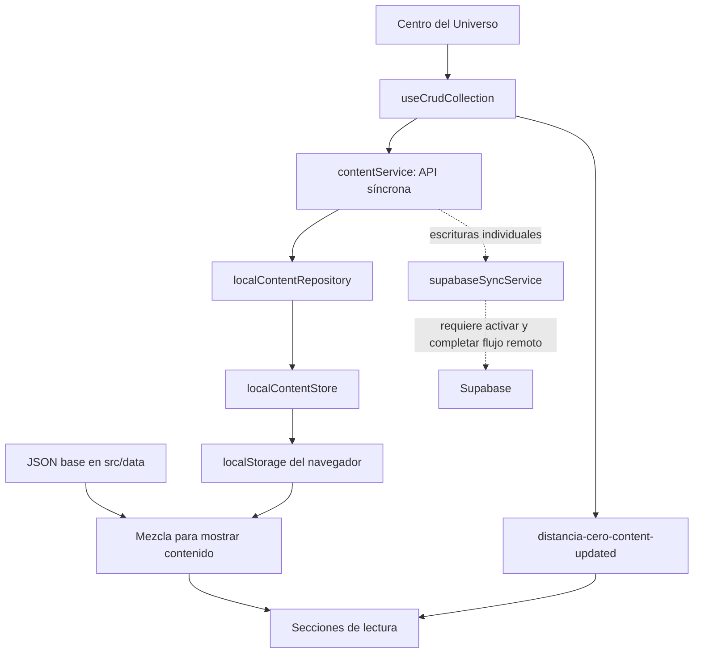

# Distancia Cero — contexto para continuar

Revisión del 13 de septiembre de 2026. Referencia Git: `main` / `0c1e46f0d42143409a037a78ff75ed1fb0f25f21`, más los cambios locales que ya existían. Este documento describe esa instantánea; al retomarlo, comprobar `git status`, el diff y los archivos afectados.

El estado posterior y los resultados del refactor/pulido están en [AVANCE_PULIDO_LOCAL.md](AVANCE_PULIDO_LOCAL.md). Las conclusiones de abajo se conservan como evidencia histórica; no sustituyen la arquitectura ni los comandos vigentes de [CLAUDE.md](../CLAUDE.md).

## Qué es el proyecto y qué experiencia busca

Distancia Cero es una experiencia romántica para dos personas, preparada ahora como plantilla personalizable. Su valor está en recorrer un universo con cartas, recuerdos, música, planetas y metáforas visuales de la relación. El CMS integrado permite que el contenido crezca sin editar código para cada cambio.

La estructura actual tiene tres partes que conviene entender juntas:

1. **La experiencia:** landing, navegación por escenas, universo 3D, galería, cartas, razones, diario, playlist y contadores.
2. **La edición:** Centro del Universo, con nueve colecciones, originales editables mediante overrides, creaciones locales, ocultación, progreso y respaldos.
3. **La infraestructura:** persistencia local, identidad simulada y código de Auth/Storage/sincronización remota que todavía necesita trabajo para operar correctamente.

El backlog reciente apunta a ampliar **Entrelazados**, pulir la experiencia y el CMS, y preparar el uso real posterior. No hay evidencia en el código de que se pretenda convertirlo ahora en una plataforma SaaS general. La dirección visual existente —espacio oscuro, rosa/rojo, transparencias, volumen y movimiento— es parte de la intención del producto.

## Alcance y método de esta revisión

Se inventariaron todos los commits alcanzables y se recorrieron los mensajes completos de `main`, las ramas, tags, stash y los hitos estructurales. Se contrastaron el árbol actual, cambios locales, documentación, configuración y estado disponible en GitHub. Se leyeron los flujos centrales y se ejecutaron comprobaciones técnicas y pruebas de comportamiento con contenido sintético en contextos de navegador nuevos.

El [inventario del historial](HISTORIAL_GIT_CODEX.md) contiene los 308 commits de `main` y los dos commits adicionales del stash. El inventario completo no equivale a una auditoría línea por línea de todos los diffs históricos. Los resultados de backend son análisis del código local: no se conectó ni modificó una base de datos remota.

## Estado de Git y GitHub

| Aspecto | Estado comprobado |
| --- | --- |
| Repositorio | [yori7v7/DistanciaCero](https://github.com/yori7v7/DistanciaCero), público |
| Rama local y remota | `main`, ambas en `0c1e46f` |
| Historial de `main` | 308 commits; 15 de mayo–6 de agosto de 2026 |
| Todos los refs locales | 310 commits: los anteriores más dos objetos de commit del stash |
| Distribución por mes | Mayo 8; junio 110; julio 163; agosto 27 |
| Ramas efectivas en GitHub | Solo `main`, según `git ls-remote --heads origin` |
| Refs remotos locales antiguos | `origin/arquitectura-content-service` y `origin/version-estable-escenas-musica`; no son ramas actuales del servidor |
| Tags | 119 locales; ninguno anunciado por `git ls-remote --tags origin` |
| Stash | Uno: `fbab2cc`, WIP de depuración de lazy loading sobre `48e352f` |
| PRs, issues y deployments de GitHub | Las consultas devolvieron listas vacías |
| Creación del repo actual de GitHub | 6 de agosto; el historial conservado es anterior |
| Último CI | [31133213522](https://github.com/yori7v7/DistanciaCero/actions/runs/31133213522): `verify` y `e2e` exitosos sobre `0c1e46f` |

No quedan cientos de commits de `main` pendientes de subir: eso es una nota obsoleta de `TODO.md`. Sí existen modificaciones locales posteriores al último commit, detalladas abajo.

**Historial personalizado:** `02fdca2` sanitizó el árbol de trabajo para convertirlo en plantilla. Sus ancestros siguen siendo alcanzables y conservan configuración personalizada y archivos antiguos de imágenes/audio. La visibilidad pública del repo incluye ese historial. Antes de ampliar su difusión conviene decidir qué historial se desea conservar público; esta revisión no reescribió commits ni alteró la visibilidad del repositorio.

## Cómo llegó al estado actual

| Etapa | Qué cambió | Referencias |
| --- | --- | --- |
| Mayo: experiencia inicial | Primera versión, música por sección, navegación por escenas y lector de cartas. | `310741c`, `2c5317d`, `ff8d260`, `6ce566a`, `3dc13a8` |
| Junio: editor local | Centro del Universo; creación de cartas; CRUD, overrides, ocultación y respaldo para las colecciones. | `1e591a2`, `265edee`, `16af585`, `effbbad`, `345dc29` |
| Junio: separación de datos | Componentes pasan a usar `contentService`; aparece repositorio local, identidad y metadata. | `51f65e0`, `066e89f`, `6a5ac2d`, `dae0929` |
| Junio–principios de julio: laboratorio remoto | Documentación extensa de schema/RLS, fixtures, validadores y migraciones controladas. Explica gran parte de los commits y tags históricos. | `abd9942`, `b11e204`, `79e1f84`, `e717d0b`, `8983c1b` |
| 8 de julio: implementación remota y rutas | Se añaden AuthGate, Auth/sync, Storage, uploads, landing, React Router, PWA y configuración Vercel. | `7674db0`, `7573579`, `405fc22`, `2cc91ea` |
| 14 de julio: plantilla | Se retira personalización, media y schema de producción del árbol actual; se permiten valores vacíos y ejemplos genéricos. | `02fdca2`, `4d71f80`, `9301b24`, `765564b` |
| 20 de julio: extracción de CMS y evolución visual | Hook/panel CRUD, eliminación de handlers repetidos, primeras pruebas, lazy loading y varias iteraciones sobre visibilidad del agujero negro. | `aa67ed7`, `e13b140`, `ea85129`, `dd3a1b5`, `d476832` |
| 22–27 de julio: TypeScript, CSS y cobertura | Migración TSX, consolidación de CSS, nueve colecciones con hook común, pruebas y catálogo de diseño. | `4e2764c`, `a5b60c7`, `875daca`, `481eda7`, `87ca2d5` |
| Agosto: consolidación | Merge de arquitectura, Playwright/CI, Entrelazados, correcciones de navegación y del centro del universo 3D. | `0fe69af`, `f560fc1`, `5677407`, `e7fa4cd`, `0c1053c`, `0c1e46f` |

El historial revela dos zonas especialmente sensibles a regresiones: la interacción entre lazy loading, clases CSS y visibilidad de escenas; y las cartas, que han pasado de almacenamiento especial a colecciones genéricas. Las correcciones repetidas del agujero negro y del centro 3D explican varios comportamientos aparentemente particulares del código actual.

## Stack y tamaño real

Versiones resueltas por `package-lock.json`: React/React DOM 19.2.6, React Router 7.18.2, Vite 8.0.16, TypeScript 7.0.2, Tailwind 4.3.3, Three.js 0.184.0, Supabase JS 2.108.2, Vitest 4.1.10 y Playwright 1.62.1. La versión de React Router incluye un cambio local sin commit. Node utilizado para esta revisión: 22.17.1.

La instantánea contiene 43 archivos TSX, 28 TS, 15 JSON y un CSS dentro de `src` —estos conteos incluyen tests—, unas 9.425 líneas TS/TSX de aplicación excluyendo `src/__tests__`, y 6.441 líneas CSS. Los archivos principales por tamaño son:

| Archivo | Líneas | Papel |
| --- | ---: | --- |
| `src/styles/tailwind.css` | 6.441 | Tokens, estilos, estados de escenas, animaciones y responsive |
| `src/components/BlackHoleGallerySection.tsx` | 652 | Galería 3D, entrada, selección y estados visuales |
| `src/components/CentroUniversoSection.tsx` | 644 | Configuración y coordinación de los nueve módulos del CMS |
| `src/services/supabaseSyncService.ts` | 505 | Pull y escrituras remotas en segundo plano |
| `src/components/SceneMusicController.tsx` | 498 | Banda sonora, transiciones, volumen y reproducción por escena |
| `src/components/UniverseSection.tsx` | 443 | Planetas, estrella central, cámara y detalles |
| `src/components/SceneModeController.tsx` | 344 | Navegación, hash, clases de visibilidad y ajustes |

`CentroUniversoSection` ya fue reducido de manera importante: las notas que lo describen como un archivo actual de 3.200–5.000 líneas no corresponden a esta versión.

## Mapa de la experiencia

`main.tsx` crea `BrowserRouter` y dos rutas. `/` muestra `PublicLanding`; `/app` monta `AudioProvider` y `App`. `App` contiene `AuthGate`, las secciones y ambos controladores de navegación/música. Las escenas usan hashes como `/app#/cartas`, dentro de la ruta `/app`.

| Escena | Secciones / función |
| --- | --- |
| `inicio` | Hero, propuesta, contadores y carta principal |
| `universo` | Sistema solar, selección de planetas/estrella y transición de cámara |
| `galeria` | Agujero negro, transición de entrada, recuerdos y detalle |
| `entrelazados` | Dos cubos animados, conexión luminosa y partículas; Fase 1 visual |
| `razones` | 100 razones con movimiento, selección y detalle |
| `historia` | Diario / timeline |
| `cartas` | Cartas mensuales y “Abrir cuando…” |
| `musica` | Playlist, reproductor y ruta prevista para uploads de audio |
| `promesas` | Fechas importantes, sueños y promesas |
| `distancia` | Representación de distancia y relación |
| Centro del Universo | Panel adicional activable en Ajustes; no es una escena normal de la barra |

`src/data/scenes.json` define once entradas: diez escenas de navegación más el Centro. `musicSectionId` conecta cada escena con la banda sonora. `SceneModeController` guarda la escena en localStorage, actualiza el hash y añade `scene-visible`, `scene-hidden` y `aria-hidden` a elementos del DOM. Un `MutationObserver` aplica esas clases cuando terminan de montar secciones lazy.

Las secciones lazy están declaradas en el JSX de `App` desde el comienzo. El cambio de escena se implementa principalmente ocultando/mostrando DOM; no equivale a montar únicamente la escena activa. Esta distinción importa al optimizar carga, memoria o animaciones. En Three.js no se observó un control explícito de `frameloop` por escena; conviene medir el consumo antes de ampliar efectos.

Entrelazados ya tiene geometría, flotación, rotación, halos y conexión visual. El comentario “cubos conscientes” expresa la intención creativa; el código actual es animación determinista y no implementa agentes autónomos ni IA.

## Datos, CMS y persistencia

En `HEAD` había un `contentRepository.ts` de una línea entre servicio y repositorio local. El working tree lo elimina y cambia el import del servicio; el diagrama refleja el working tree.

El modelo de contenido distingue:

- **Originales:** datos JSON compilados con la app. Editarlos desde el CMS crea un override por ID; no modifica el archivo JSON.
- **Tus creaciones:** objetos en localStorage con `isLocal`, ID y metadata de creación/edición.
- **Ocultos:** lista de IDs de originales que se excluyen de la vista. Ocultar no elimina el dato base.
- **Progreso:** claves de lectura de cartas independientes del contenido.
- **Simulación:** bandera local para probar cartas bloqueadas.

El merge conserva los IDs base, aplica overrides, excluye originales ocultos y añade los elementos locales. `contentService` es la fachada pública que deben usar las secciones; `localContentStore` concentra las claves del CRUD. La identidad, preferencias de escena, música y otros estados tienen almacenamiento propio: no es correcto afirmar que un solo archivo de todo el proyecto toca localStorage.

`useCrudCollection` concentra formularios, edición, creación, ocultación/restauración y contadores. `CrudEditorPanel` representa esos estados. El contenedor configura campos y transformaciones para nueve colecciones: `reasons`, `promises`, `importantDates`, `futureDreams`, `timeline`, `blackHoleGallery`, `playlist`, `monthlyLetters` y `openWhenLetters`.

Las claves genéricas siguen `distancia-cero-content-<colección>`, con sufijos `-overrides` y `-hidden`. Las cartas mantienen además dos claves antiguas y una migración marcada por `distancia-cero-legacy-migrated-v1`. Esa coexistencia es relevante para respaldos y borrado.

La actualización entre componentes usa eventos del navegador y estados locales React, no un almacén global reactivo de contenido. Guardar en localStorage y emitir el evento son responsabilidades distintas. Esto explica por qué cambiar una clave o remontar una parte del CMS no garantiza refrescar todos los consumidores.

La plantilla trae 100 razones; tres elementos en la mayoría de colecciones; cinco entradas de playlist y cuatro promesas. `randomPhrases.json` está vacío. Hay quince JSON en total. Nombres, fechas y rutas vacías son parte de la plantilla actual: no todos los textos visibles incompletos son errores de renderizado.

## Identidad y estado real de Supabase

La identidad local usa `local-user1` y `local-user2`; es una selección de autor para el contenido local. El acceso local a `/app` funciona sin login remoto y el CMS se activa desde Ajustes. Eso no constituye autorización de servidor ni garantiza privacidad del contenido compilado.

Existe código efectivo para login, registro, confirmación, restauración de sesión, consultas de membresía, uploads y sincronización. `remoteContentRepository.ts` continúa siendo un skeleton, pero **el motor remoto que se intentó integrar usa servicios separados**, no ese repositorio como selector. Por eso “todo Supabase es un skeleton” sería una descripción incorrecta.

El flujo previsto es: AuthGate restaura/inicia sesión, comprueba un espacio con `universe_members`/`bootstrap_space`, hace pull de `content_items` a localStorage y notifica a la UI. Las escrituras individuales del servicio intentan hacer push en segundo plano. Storage prevé buckets de imágenes/audio/videos y URLs firmadas.

El funcionamiento remoto completo no está verificado ni listo para darse por hecho:

- `isRemoteContentEnabled()` sin argumento lee un objeto vacío, mientras sus consumidores lo llaman precisamente sin argumento. `getDefaultEnv()` solo se usa en la creación del cliente. Activar la variable de entorno por sí sola no arregla ese flujo.
- No hay schema/migraciones de producción en el árbol actual. `docs/supabase/production_schema.sql` se eliminó en la sanitización, aunque README/CLAUDE todavía remiten a esa documentación.
- El pull reemplaza grupos locales presentes en la respuesta, no implementa una cola de cambios offline ni un merge real por timestamps. Limita consultas a 1.000 filas y omite sobrescribir grupos vacíos, lo que puede conservar datos locales que ya no existen remotamente.
- Los guardados masivos y helpers legacy no hacen el mismo push que las operaciones individuales. Importar un respaldo no implica sincronizarlo.
- El borrado remoto busca `_supabaseId` en un objeto local después de que el servicio ya lo borró. Es un defecto latente adicional cuando se habilite el remoto.
- `ensureSpaceSetup()` inicia el RPC sin esperarlo, aun cuando el llamador espera a `ensureSpaceSetup`. `lastSyncError` no se presenta como estado de sincronización en la UI.

Estos puntos describen el código; no afirman que una cuenta o una base remota concreta tengan datos dañados.

## Música, diseño y despliegue

Hay dos sistemas de audio: `AudioContext` maneja un tema principal y canciones individuales mediante objetos `new Audio()`, y `SceneMusicController` gestiona su elemento de audio, volumen, desbloqueo por interacción y cambios de pista por escena. La función que pausa otros audios del segundo solo recorre elementos `<audio>` del DOM, por lo que no alcanza necesariamente los objetos separados del contexto. La coordinación de reproducción requiere atención si se añaden pistas reales.

`resolvePublicPath` del contexto antepone `BASE_URL` también a URLs absolutas. Una canción subida obtiene una URL HTTPS firmada y termina tratada como ruta local. El controlador de escenas tiene otra función que sí conserva URLs HTTP(S); existe lógica duplicada con comportamientos diferentes.

Los tokens y estilos viven en `src/styles/tailwind.css`; `design-system/` es un catálogo HTML estático de referencias, no una biblioteca de componentes React. Al tocar CSS hay que respetar layers de Tailwind, estilos de escenas y transiciones existentes. Buena parte del historial de problemas visuales se explica por esa interacción.

Se comprobó landing y entrada a la app a 1.440 px; Entrelazados a 390 px no produjo overflow horizontal ni errores JavaScript capturados. En ese tamaño el reproductor flotante ocupa una parte considerable del canvas y la navegación se superpone a la etiqueta superior. Es una observación puntual de layout, no una auditoría completa de accesibilidad o rendimiento móvil.

Vite usa base `/` por defecto y permite `VITE_BASE=/DistanciaCero/`. Existe `public/404.html` para la historia de GitHub Pages y `vercel.json` con reescrituras SPA. `npm run deploy` aún ejecuta `gh-pages -d dist`; el workflow actual verifica, no despliega. No se confirmó un sitio publicado activo. La PWA genera service worker y precache en producción.

## Cambios locales que estaban en curso

| Archivos | Intención y estado observado |
| --- | --- |
| `MonthlyLetters.tsx`, `OpenWhenSection.tsx`, nuevo `LetterCollectionSection.tsx` | Extraer un lector común parametrizado. Reduce duplicación, pero el nuevo tipo inferido genera 15 errores de TypeScript. |
| `CentroUniversoSection.tsx` | Sustituir recargas completas por `contentKey`. El estado del componente padre no se reinicializa al cambiar la key del `<section>`; se reprodujo una regresión de simulación. |
| `SceneModeController.tsx` | Al salir, navegar a `/` en vez de recargar toda la página. No se probó logout remoto porque el remoto no está operativo. |
| `AudioContext.tsx` | Validar protocolos HTTP/HTTPS antes de abrir enlaces externos de la playlist. |
| `contentService.ts`, eliminación de `contentRepository.ts` | Quitar el re-export intermedio manteniendo la API del servicio. |
| `package.json`, `package-lock.json` | Actualizar React Router de `^7.15.1` a `^7.18.2`. |
| `AUDITORIA_ARQUITECTURA.md` | Informe previo sin seguimiento en Git; algunas conclusiones y estadísticas ya no describen el working tree. |
| `.agents/`, `AGENTS.md` | Adaptación de skills realizada en esta conversación antes del análisis. |

No se deben mezclar estos cambios con el estado del último CI publicado. Ninguno fue revertido ni se creó un commit durante el análisis.

## Hallazgos confirmados que afectan la continuación

| Prioridad/contexto | Hallazgo y evidencia | Punto de entrada |
| --- | --- | --- |
| Bloquea el siguiente CI del working tree | 15 errores TS2339 al acceder a `title`, `content`, `locked`, etc. en la unión inferida del lector común. Vite transpila, pero `tsc` falla. | `LetterCollectionSection.tsx:93`, `:146` |
| Integridad del contenido local | Restaurar una carta con un ID ya presente en la colección estándar conserva el contenido estándar; al borrarla puede reaparecer su copia legacy. Reproducido con datos sintéticos: tras importar “Version de respaldo” se leyó “Version nueva”; tras borrar se leyó “Version de respaldo”. | `localContentRepository.ts:152`, `:160`, `:233`; `centro-universo/BackupPanel.tsx:135` |
| Regresión local de simulación | Pulsar “Activar Modo Prueba” escribe `1`, pero el botón sigue mostrando “Activar”; pulsarlo otra vez deja `1`. La key del nodo hijo no reinicia `isSimUnlocked` ni actualiza los lectores hermanos. Reproducido en UI. | `CentroUniversoSection.tsx:298`, `:387` |
| Activación remota futura | El feature flag sin argumento siempre resulta falso; consumidores de Auth, sync y uploads usan esa llamada. Evidencia de implementación y comparación de llamadas con/sin argumento. | `integrations/supabase/client.ts:42`, `:156` |
| Borrado remoto futuro | El servicio elimina el objeto local antes de intentar recuperar su `_supabaseId` para soft delete. | `contentService.ts:83`; `supabaseSyncService.ts:416` |
| Audio con archivos remotos | El contexto convierte `https://...` en una ruta bajo la base de la app; playlist le pasa URLs firmadas como `src`. | `AudioContext.tsx:11`, `:126`; `PlaylistSection.tsx:62` |
| Verificación antigua | El script de aislamiento falla por referencias a archivos `.js` que ya no existen. | `scripts/verify-supabase-isolation.mjs:287` |

Las prioridades de remoto corresponden a una futura activación. Para seguir trabajando en la experiencia local, los problemas inmediatos son el refactor incompleto de cartas, los respaldos y la actualización del estado de simulación.

## Comprobaciones ejecutadas

| Comprobación | Resultado |
| --- | --- |
| `tsc --noEmit` | Falla: 15 errores, todos en el nuevo `LetterCollectionSection.tsx` |
| `npm run build` con remoto desactivado | Pasa, incluida generación PWA |
| Vitest por defecto | Falla al iniciar once workers de tipo forks; las pruebas no llegaron a ejecutarse |
| Vitest con un fork | Se detuvo tras quedar sin progreso; no se contó como resultado de pruebas |
| `node node_modules/vitest/vitest.mjs run --pool=threads --maxWorkers=1 --no-file-parallelism` | **11 archivos, 162 pruebas aprobadas**, 87,96 s |
| Suite Playwright actual | **11 aprobadas, 1 timeout** al esperar CMS, 2,7 min |
| Repetición aislada de ese caso CMS | **Aprobada**, 7,2 s de prueba; no se volvió a ejecutar toda la suite |
| Navegador con contexto nuevo | Landing, entrada a `/app`, CMS y vista móvil de Entrelazados cargan; sin errores JavaScript de página capturados en esas comprobaciones |
| Reproducciones de datos | Confirman restauración/borrado legacy y simulación; contenido sintético dentro de un navegador aislado |
| Verificador de aislamiento | Falla con ENOENT al leer `src/repositories/contentRepository.js` |

El build produjo aproximadamente 533 kB para el chunk principal JS (154 kB gzip), 882 kB para el chunk compartido 3D (235 kB gzip), CSS de 139 kB (27 kB gzip) y un precache PWA de unos 1.640 KiB. Vite advirtió que `supabaseSyncService` también se importa estáticamente: su import dinámico desde el servicio no consigue aislarlo en otro chunk. Esas cifras no son una medición de tiempo de carga ni de FPS.

La suite unitaria se concentra en almacenamiento, repositorio, servicio, metadata, helpers y el hook CRUD, más algunos componentes sencillos. No cubre el lector común nuevo, la coordinación de audio, los backups completos, las transiciones 3D ni un backend real. En `e2e/cms-crud.spec.ts` el caso CRUD principal modifica localStorage mediante `page.evaluate`; comprueba persistencia, pero no el recorrido real de crear/editar/eliminar usando formularios.

El timeout aislado del CMS pasó al repetirlo. Con esa evidencia puede describirse como una inestabilidad observada bajo la carga de esta revisión; no hay base para atribuirle una causa única ni para presentar toda la suite inicial como verde.

## Documentación que debe leerse con contexto

- `CLAUDE.md` contiene reglas útiles, pero mezcla números históricos y referencias a archivos/schema eliminados. Su afirmación de aislamiento total de imports remotos tampoco coincide con el warning del build.
- `CONTENT_CONTRACT.md` conserva invariantes válidos; su diagrama aún incluye el re-export que el working tree elimina.
- `IDENTITY_CONTRACT.md` habla de propuestas futuras y rutas `.js` aunque varios servicios ya existen en `.ts`.
- `TODO.md` sigue diciendo que falta subir cientos de commits y reescribir la guía; `main` ya está sincronizada y `GUIA_PARA_EDITAR.md` ya tiene enfoque CMS.
- La memoria de julio contiene cifras incompatibles entre sí —por ejemplo cero tests y luego 17—. Sirve para explicar decisiones pasadas, no para comprobar el estado presente.
- El informe previo `AUDITORIA_ARQUITECTURA.md` se debe contrastar antes de ejecutar sus recomendaciones. Un cambio sugerido allí, como reemplazar recargas por una key, necesita validar el estado real que se esperaba refrescar.

## Cómo retomar sin perder el hilo

Primero revisar `git status` y decidir el alcance del trabajo solicitado sobre el refactor local. La base más útil para continuar es estabilizar el lector común y los flujos de cartas/simulación, preservando el contenido y comportamiento existentes. Las pruebas relevantes para esa etapa son TypeScript, lectura y edición de ambas clases de cartas, restauración de respaldo, progreso y alternancia real de simulación.

Para ampliar **Entrelazados**, los archivos de entrada son `EntrelazadosSection.tsx`, `scenes.json` y los estilos correspondientes. Para mejorar **CMS**, empezar por la configuración en `CentroUniversoSection`, el hook y `CrudEditorPanel`. Para **audio**, considerar juntos el contexto y el controlador de escenas. Para **remoto**, definir y comprobar primero el contrato y el flujo completo; corregir solo el flag no resuelve los demás pendientes.

Mantener los invariantes que ya tienen sentido para el proyecto: lectura/edición local funcional, API síncrona del contenido, IDs base estables, separación entre originales/overrides/creaciones, datos de prueba separados de contenido real y preservación del almacenamiento existente. Validar cambios visuales en navegador, especialmente cuando afecten lazy loading, visibilidad y escenas.

Esta revisión agregó documentación de contexto. No se implementaron correcciones de la aplicación, no se desplegaron cambios ni se hicieron commits o modificaciones de recursos de GitHub.
